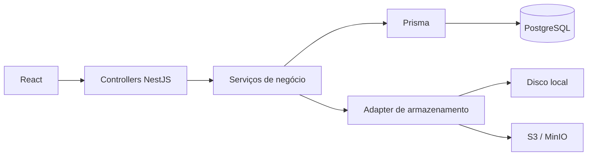

# ClinicFlow

**Gestão operacional de clínicas, da agenda ao retorno do paciente.**

Aplicação full-stack que reúne agendamento, recepção, sala de espera, documentos e tarefas de acompanhamento em um monorepo. O foco técnico está em modelar o fluxo da consulta, validar disponibilidade e manter as operações da equipe consistentes.

[Executar localmente](#executar-localmente) · [Decisões técnicas](#decisões-técnicas) · [Testes](#testes) · [Regras de negócio](docs/CLINICFLOW-CONTEXTO.md)

## Funcionalidades

- Agenda de profissionais com consulta de horários disponíveis e detecção de sobreposição.
- Ciclo da consulta: agendamento, confirmação, check-in, atendimento e conclusão.
- Cadastro de pacientes e profissionais, com horários de trabalho configuráveis.
- Sala de espera e painel de chamada.
- Documentos com armazenamento local ou compatível com S3.
- Tarefas de retorno, registro de contatos e rotinas periódicas.
- Autenticação com JWT, renovação de sessão e controle de acesso por perfil.

## Stack

| Camada | Tecnologias |
|---|---|
| Frontend | React 19, TypeScript, Vite, Tailwind CSS, TanStack Query |
| Backend | NestJS 11, Prisma 6, PostgreSQL 16 |
| Testes | Jest, Supertest, Vitest, Testing Library e Playwright |
| Tooling | pnpm workspaces, Turborepo e Biome |
| Ambiente local | Docker Compose; Redis e MinIO disponíveis como serviços auxiliares |

## Decisões técnicas

| Decisão | Como aparece na implementação |
|---|---|
| Máquina de estados sem I/O | As transições permitidas da consulta ficam em uma função testável sem banco: [máquina de estados](apps/api/src/modules/appointments/appointment-status.machine.ts) e [testes](apps/api/src/modules/appointments/appointment-status.machine.spec.ts). |
| Disponibilidade como serviço próprio | A [verificação de disponibilidade](apps/api/src/modules/appointments/availability.service.ts) considera intervalos sobrepostos, duração e agenda do profissional. |
| Horário da clínica explícito | Utilitários de tempo e relógio injetável permitem tratar o fuso da clínica e testar regras dependentes de horário. Veja [utilitários](apps/api/src/common/utils/clinic-time.util.ts) e [relógio](apps/api/src/shared/clock). |
| Armazenamento por adapter | Os módulos usam o mesmo serviço, enquanto a configuração seleciona disco local ou S3: [storage](apps/api/src/shared/storage). |
| Prevenção de tarefas duplicadas | O [serviço de criação de tarefas do sistema](apps/api/src/modules/tasks/services/create-system-task.service.ts) consulta tarefas abertas antes de registrar outra do mesmo tipo. |



## Executar localmente

Requisitos: **Node.js 22.12+**, **pnpm 10.11.1**, Docker e Docker Compose.

```bash
git clone https://github.com/danielharrisonlf/clinicflow.git
cd clinicflow
pnpm install
cp apps/api/.env.example apps/api/.env
cp apps/web/.env.example apps/web/.env
docker compose up -d postgres redis
pnpm --filter api db:generate
pnpm --filter api db:migrate
pnpm --filter api db:seed
pnpm start:dev
```

O seed recria dados de demonstração: use um banco local dedicado ao projeto. Os exemplos de configuração usam notificações em modo `log` e armazenamento local, permitindo experimentar sem credenciais externas.

| Serviço | Endereço |
|---|---|
| Frontend | http://localhost:5173 |
| API | http://localhost:3000/api/v1 |
| Swagger | http://localhost:3000/docs |

Contas locais criadas pelo seed, com senha **`clinicflow123`**:

| Perfil | E-mail |
|---|---|
| Recepção | `renata.souza@clinicaviver.com.br` |
| Gestão | `gestao@clinicaviver.com.br` |

Para executar os apps separadamente:

```bash
pnpm --filter api start:dev
# Em outro terminal:
pnpm --filter web dev
```

Para experimentar S3 local, suba `docker compose up -d minio` e configure `STORAGE_DRIVER=s3` e as variáveis `S3_*` do exemplo da API.

## Roteiro de demonstração

1. Entre com o perfil de recepção e consulte a agenda do dia.
2. Abra um paciente e tente agendar um horário já ocupado para observar a validação de conflitos.
3. Confirme uma consulta, registre o check-in e acompanhe a sala de espera.
4. Inicie e conclua o atendimento, observando as transições de estado.
5. Explore documentos e tarefas de acompanhamento do paciente.

## Testes

```bash
# API: testes unitários
pnpm --filter api test

# API: integração/E2E; exige PostgreSQL disponível
pnpm --filter api test:e2e

# Frontend: componentes e hooks
pnpm --filter web test

# Frontend: fluxos no navegador
pnpm --filter web exec playwright install chromium
pnpm --filter web test:e2e

# Qualidade e build do monorepo
pnpm check
pnpm build
```

A suíte inclui testes da máquina de estados, mapeamento de consultas, serviços e componentes. Consulte as configurações de E2E de cada app para preparar o ambiente correspondente.

## Estrutura

```text
apps/
  api/            API NestJS, schema/migrations Prisma e testes
  web/            SPA React e testes de interface
packages/config/  Configurações compartilhadas de TypeScript, Jest e Biome
docs/             Contexto do produto e fluxo de desenvolvimento
```

Na API, `src/modules` organiza os domínios; `src/common` concentra guards, filtros, DTOs e utilitários; `src/shared` reúne Prisma, relógio, HTTP e armazenamento.

## Documentação e escopo

- [Contexto e regras de negócio](docs/CLINICFLOW-CONTEXTO.md).
- [Fluxo de branches e releases](docs/GIT_FLOW.md).
- [Variáveis da API](apps/api/.env.example).
- [Design da interface](DESIGN.md).

Este repositório permite demonstrar os fluxos operacionais com dados locais. Os modos de notificação e armazenamento são configuráveis; integrações reais dependem dos serviços e credenciais correspondentes. O nome histórico “ClinicFlow AI” aparece nos metadados, mas as funcionalidades descritas aqui são os fluxos implementados no código.
