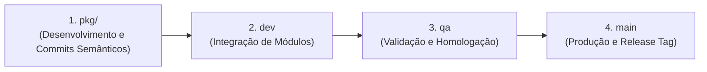

# Git Flow — ClinicFlow AI

Este documento estabelece o modelo de versionamento, fluxo de branches e ciclo de vida de releases adotado no projeto **ClinicFlow AI**.

---

## 1. Visão Geral da Estrutura de Branches

O Git Flow do projeto é estruturado em três branches de ciclo de vida permanente (`main`, `qa`, `dev`) combinadas com branches de desenvolvimento por módulo (`pkg/<modulo>`):

```mermaid
gitgraph
   commit id: "init"
   branch dev
   checkout dev
   branch pkg/infra-foundation
   checkout pkg/infra-foundation
   commit id: "feat(infra): monorepo setup"
   commit id: "chore(config): add biome and turbo"
   checkout dev
   merge pkg/infra-foundation id: "merge: pkg/infra-foundation"
   branch pkg/auth-users
   checkout pkg/auth-users
   commit id: "feat(auth): jwt and guards"
   commit id: "feat(users): access profiles"
   checkout dev
   merge pkg/auth-users id: "merge: pkg/auth-users"
   branch qa
   checkout qa
   merge dev id: "release: candidate to qa"
   checkout main
   merge qa id: "release: v0.1.0 to main" tag: "v0.1.0"
```

---

## 2. Tipos de Branches e Responsabilidades

| Branch | Tipo | Finalidade | Proteção |
|---|---|---|---|
| `main` | Permanente | Código estável em **Produção**. Recebe apenas merges validados de `qa`. | Protegida (Sem commits diretos) |
| `qa` | Permanente | Ambiente de **Homologação e Quality Assurance**. Testes de regressão, carga e validação pré-release. | Protegida (Merges vindos de `dev`) |
| `dev` | Permanente | Linha de **Integração Contínua**. Recebe os pacotes de cada módulo (`pkg/*`). | Protegida (Merges via PR ou fast-forward aprovado) |
| `pkg/<modulo>` | Temporária / Feature | Branch de **Implementação por Módulo/Pacote**. Commits semânticos e testes unitários do módulo. | Aberta para o desenvolvedor responsável |

---

## 3. Ciclo de Promoção (Lifecycle)

O fluxo operacional de entrega de código segue quatro etapas sequenciais:



### Etapa 1 — Desenvolvimento no Pacote (`pkg/<modulo>`)
- Criar a branch a partir da versão mais recente de `dev`:
  ```bash
  git checkout dev
  git pull origin dev
  git checkout -b pkg/appointments
  ```
- Implementar as funcionalidades do módulo com commits semânticos atômicos.
- Garantir que todos os testes do módulo passam localmente:
  ```bash
  pnpm check
  pnpm test
  ```

### Etapa 2 — Integração em Desenvolvimento (`dev`)
- Merge da branch de pacote em `dev`:
  ```bash
  git checkout dev
  git merge --no-ff pkg/appointments -m "merge(dev): integrate pkg/appointments"
  ```

### Etapa 3 — Validação em QA (`qa`)
- Após o fechamento de um ciclo ou milestone de pacotes em `dev`, promove-se para `qa`:
  ```bash
  git checkout qa
  git merge --no-ff dev -m "release(qa): promote dev to qa for validation"
  ```
- Execução de testes de integração, testes E2E e validações operacionais.

### Etapa 4 — Entrada em Produção (`main`)
- Uma vez aprovado e homologado em `qa`, o código é mesclado em `main`:
  ```bash
  git checkout main
  git merge --no-ff qa -m "release(main): release v0.1.0 to production"
  git tag -a v0.1.0 -m "Release v0.1.0 - ClinicFlow AI MVP"
  ```

---

## 4. Convenção de Commits Semânticos

Seguimos a especificação do **Conventional Commits**:

$$\text{tipo(escopo)}: \text{descrição clara no imperativo}$$

### Tipos Permitidos
* `feat`: Nova funcionalidade para o usuário ou módulo.
* `fix`: Correção de bug.
* `refactor`: Alteração de código que não altera comportamento externo nem adiciona feature.
* `test`: Adição ou correção de testes unitários ou de integração.
* `docs`: Atualizações de documentação, diagramas ou README.
* `chore`: Manutenção de dependências, configurações de build ou scripts.
* `style`: Ajustes estéticos, formatação de código ou Biome.

### Exemplos Válidos
```bash
feat(appointments): implement state machine and conflict detection
feat(patients): add paginated patient listing with search filters
fix(auth): prevent timing attack on password verification
test(storage): add unit tests for presigned upload URLs
docs(architecture): document git flow and branching strategy
```

---

## 5. Checklist Obrigatório Pré-Merge

Antes de qualquer merge para `dev`, `qa` ou `main`:
1. [x] **Lint & Format**: `pnpm run check` executado com 0 erros.
2. [x] **Testes Automatizados**: `pnpm test` executado com 100% dos testes verdes.
3. [x] **Build Limpo**: `pnpm run build` compila sem alertas críticos de TypeScript.
4. [x] **Código Limpo**: Sem comentários temporários, referências a números de mockups/telas ou código morto comentado.
