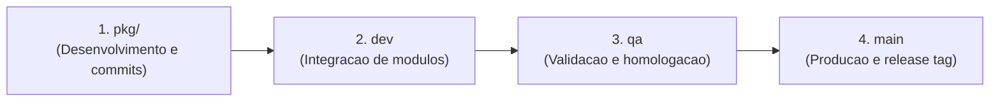

# Git Flow: ClinicFlow

Este documento descreve o modelo de branches, integracao e releases do projeto ClinicFlow.

## 1. Estrutura de branches

O projeto adota tres branches de ciclo de vida permanente (`main`, `qa`, `dev`) combinadas com branches de desenvolvimento por modulo (`pkg/<modulo>`):

```mermaid
gitgraph
   commit id: "init"
   branch dev
   checkout dev
   branch pkg/infra-foundation
   checkout pkg/infra-foundation
   commit id: "feat(infra): monorepo setup"
   commit id: "chore(config): add biome and turbo"
   checkout dev
   merge pkg/infra-foundation id: "merge: pkg/infra-foundation"
   branch pkg/auth-users
   checkout pkg/auth-users
   commit id: "feat(auth): jwt and guards"
   commit id: "feat(users): access profiles"
   checkout dev
   merge pkg/auth-users id: "merge: pkg/auth-users"
   branch qa
   checkout qa
   merge dev id: "release: candidate to qa"
   checkout main
   merge qa id: "release: v0.1.0 to main" tag: "v0.1.0"
```

## 2. Tipos de branches e responsabilidades

| Branch | Tipo | Finalidade | Protecao |
|---|---|---|---|
| `main` | Permanente | Codigo estavel em producao. Recebe apenas merges validados de `qa`. | Protegida (sem commits diretos) |
| `qa` | Permanente | Ambiente de homologacao e testes de regressao antes da release. | Protegida (merges vindos de `dev`) |
| `dev` | Permanente | Linha de integracao continua. Recebe os pacotes de cada modulo (`pkg/*`). | Protegida (merges controlados) |
| `pkg/<modulo>` | Temporaria / Pacote | Branch de implementacao por modulo ou pacote. Commits semanticos atomicos. | Aberta para o desenvolvedor |

## 3. Ciclo de promocao

O fluxo de entrega segue quatro passos sequenciais:



### Etapa 1: Desenvolvimento no pacote (pkg/<modulo>)
Crie a branch a partir da versao atualizada de `dev`:
```bash
git checkout dev
git pull origin dev
git checkout -b pkg/appointments
```

Implemente as alteracoes com commits semanticos atomicos e valide os testes localmente:
```bash
pnpm check
pnpm test
```

### Etapa 2: Integracao em dev
Faca o merge da branch do pacote em `dev` mantendo o historico visual:
```bash
git checkout dev
git merge --no-ff pkg/appointments -m "merge(dev): integrate pkg/appointments"
```

### Etapa 3: Validacao em QA
Apos concluir uma rodada de funcionalidades em `dev`, promova as alteracoes para `qa`:
```bash
git checkout qa
git merge --no-ff dev -m "release(qa): promote dev to qa for validation"
```

Em QA sao rodados os testes ponta a ponta e as validacoes integradas.

### Etapa 4: Publicacao em producao (main)
Com a homologacao concluida em `qa`, o codigo e mesclado na `main` e recebe uma tag de versao:
```bash
git checkout main
git merge --no-ff qa -m "release(main): release v0.1.0 to production"
git tag -a v0.1.0 -m "Release v0.1.0 - ClinicFlow MVP"
```

## 4. Convencao de commits

Seguimos a especificacao do Conventional Commits:

```text
tipo(escopo): descricao clara no imperativo
```

Tipos aceitos:
- `feat`: nova funcionalidade
- `fix`: correcao de bug
- `refactor`: refatoracao interna sem mudanca de comportamento
- `test`: adicao ou ajuste de testes
- `docs`: alteracoes na documentacao
- `chore`: tarefas de build, scripts ou dependencias
- `style`: ajustes de formatacao e estilo de codigo

Exemplos:
```bash
feat(appointments): implement state machine and conflict detection
feat(patients): add paginated patient listing with search filters
fix(auth): prevent timing attack on password verification
test(storage): add unit tests for presigned upload URLs
docs(architecture): document git flow and branching strategy
```

## 5. Checklist antes do merge

Antes de qualquer merge para `dev`, `qa` ou `main`:
1. Lint e formatacao: execute `pnpm run check` com zero erros reportados.
2. Testes automatizados: execute `pnpm test` com todas as suites verdes.
3. Compilacao: execute `pnpm run build` com sucesso.
4. Codigo limpo: garanta que nao ha logs temporarios, codigo morto comentado ou marcacoes provisorias.